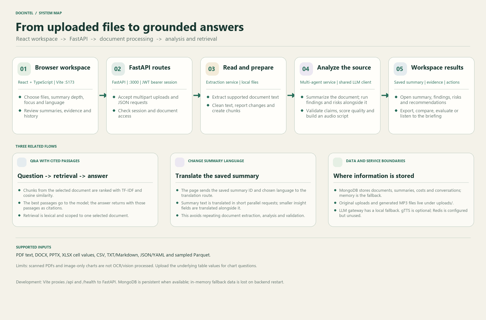

<div align="center">

# DocIntel

### Turn business documents into useful summaries and evidence-based answers.

Upload a document, explore its key points, ask questions against its contents, and create a concise audio briefing.


[Get started](#quick-start) · [Features](#features) · [Architecture](#architecture-and-documentation) · [Limitations](#known-limitations)

</div>



## Overview

DocIntel is a local-first document intelligence demo. A React and TypeScript frontend talks to a FastAPI backend that extracts document text, organizes it into chunks, and uses a configurable OpenAI-compatible model gateway for summaries and answers. MongoDB provides persistence when available; the app can fall back to process-local in-memory storage.

## Features

- **Document ingestion:** PDF, DOCX, PPTX, XLSX, TXT, Markdown, CSV, JSON, YAML, and Parquet.
- **Tailored summaries:** Executive or detailed summaries with focus areas, instructions, and optional questions.
- **Evidence-oriented results:** Key findings, risks, recommendations, action items, claims, and a processing trace.
- **Document Q&A:** Ask about one selected document and inspect the retrieved source passages used as citations.
- **Quick language changes:** Translate a saved summary without rerunning document extraction and analysis.
- **Workspace tools:** Document history, comparison, cleanup reports, quality views, cost estimates, and audio briefings.
- **Light and dark themes.**

## Quick start

### Windows

Requirements: Python 3.11, Node.js 18 or newer, and npm. Docker Desktop is optional.

1. Clone the repository and open its folder in a terminal.
2. Create your local environment file and add a valid model gateway key if you want AI summaries and translations:

   ```powershell
   Copy-Item .env.example .env
   ```

   Set `OPENROUTER_API_KEY` in `.env`. Keep this file private; it is excluded by `.gitignore`.
3. Start the app:

   ```bat
   start.bat
   ```

When Docker is available, the script starts MongoDB and Redis. Otherwise, the backend can use in-memory storage; that data is lost when the backend stops. The script opens a backend and a frontend terminal. Once both are ready, visit **http://localhost:5173**.

| Service | Local URL |
|---|---|
| Web app | [http://localhost:5173](http://localhost:5173) |
| API health | [http://localhost:3000/health](http://localhost:3000/health) |
| API readiness | [http://localhost:3000/ready](http://localhost:3000/ready) |
| Interactive API docs | [http://localhost:3000/docs](http://localhost:3000/docs) |

### Manual development setup

Create the Python environment once:

```powershell
python -m venv venv
.\venv\Scripts\activate
python -m pip install -r requirements.txt
```

In one terminal, start the backend from the repository root:

```powershell
.\venv\Scripts\activate
uvicorn main:app --host 127.0.0.1 --port 3000 --reload
```

In another terminal, start the frontend:

```powershell
cd frontend
npm install
npm run dev
```

The Vite development server proxies `/api` and `/health` requests to FastAPI on port `3000`.

## Demo sign-in

This project uses **demo authentication**, not a real user system. Use any email address and the shared password `password123`. For the sample administrator profile, use `admin@company.com`.

Do not expose this demo login or the default development configuration on a public deployment. Production use needs real identity management, strong secret configuration, and deployment-specific access controls.

## Model gateway

The backend reads `OPENROUTER_API_KEY`, `OPENROUTER_BASE_URL`, and `OPENROUTER_MODEL` from `.env`. The example file contains a placeholder; replace it with a valid credential or leave it blank for local development. Local fallback behavior is limited: some Q&A and analysis tasks can return basic heuristic results, while full summary generation and translation need a reachable model gateway.

Changing a summary's language makes a translation request for the saved summary. It does not rerun the whole analysis pipeline, but it still depends on the gateway and its response time.

## Known limitations

- **No OCR or image understanding:** PDF extraction reads embedded selectable text. Scanned pages, image-only charts, and embedded figures are not interpreted. For charts, provide the underlying CSV/XLSX values or include readable labels and numbers in the document.
- **Spreadsheet scope:** XLSX extraction reads cell values, not chart graphics. Parquet ingestion samples up to 15 rows.
- **Lexical retrieval:** Q&A ranks text chunks with TF-IDF and cosine similarity. It does not use embeddings or a vector database, and questions are scoped to one selected document.
- **Storage fallback:** In-memory records disappear when the backend process stops. Uploaded files are stored locally under `uploads/`.
- **Evaluation scores:** Some quality, confidence, and ROI figures are heuristic estimates, not independent guarantees or calibrated measurements.
- **Demo security:** Authentication is permissive and unsuitable for production.

## GovReport evaluation dataset

DocIntel's quality page can evaluate summaries against the **GovReport long-document summarization dataset**, which pairs long government reports with human-written summaries. The dataset is useful for evaluating long-document summarization and source-grounded analysis. Reports can also be used as inputs to the audio briefing flow after their summaries are generated and reviewed.

Dataset sources:

- [Hugging Face dataset](https://huggingface.co/datasets/launch/gov_report) — downloadable dataset files and dataset card.
- [Official GovReport data site](https://gov-report-data.github.io/) — project dataset information and download resources.
- [Authors' code and dataset resources](https://github.com/luyang-huang96/LongDocSum).
- [Original NAACL paper](https://aclanthology.org/2021.naacl-main.112/) — background and citation.

The public dataset is available in JSONL/text forms; fields include a document/report, its summary, and an ID, with metadata depending on the source or export. The DocIntel evaluator currently looks for Parquet shards at `app/data/train-00000-of-00002.parquet` and `app/data/train-00001-of-00002.parquet`, with `report` and `summary` columns. Download or prepare compatible shards locally; these large Parquet files are intentionally excluded from Git because each exceeds GitHub's 100 MB file limit. The files are not included in a fresh clone.

## Application pages

| Route | Purpose |
|---|---|
| `/login` | Demo sign-in and product overview |
| `/` | Upload documents and set summary preferences |
| `/documents` | Browse documents and select files to compare |
| `/history` | Review upload and summary history |
| `/summary` | Read summaries, findings, risks, claims, and audio briefings |
| `/cleaning` | Inspect extracted text and cleanup reports |
| `/compare` | Compare two documents |
| `/quality` | Evaluate summaries and inspect the GovReport sample benchmark |
| `/costs` | Review estimates and budget information |
| `/settings` | Frontend-only settings controls |

## Technology

| Area | Main technologies |
|---|---|
| Frontend | React 18, TypeScript, React Router, Vite |
| API | FastAPI, Uvicorn, Pydantic |
| Extraction | pypdf, Python ZIP/XML, openpyxl, pandas, PyArrow |
| Retrieval | Project-local TF-IDF and cosine similarity |
| AI | OpenAI-compatible gateway with limited local fallback |
| Persistence | MongoDB through Motor, with in-memory fallback |
| Audio | gTTS and browser Web Speech API fallback |
| Optional infrastructure | Docker Compose, Redis, Nginx |

Redis is provisioned in the optional Docker stack but is not currently used by request code.

## Project structure

```text
main.py                         FastAPI application and API routes
app/config.py                   Environment-based application settings
app/database.py                 MongoDB and in-memory persistence
app/services/                   Extraction, retrieval, LLM, analysis, audio, and evaluation
app/data/                       Locally downloaded GovReport evaluation data (git-ignored)
frontend/src/                   React app, pages, components, and styles
uploads/                        Local uploads and generated audio (git-ignored)
start.bat                       Windows quick start
docker-compose.yml              Optional local infrastructure
architecture.md                 Detailed architecture and implementation notes
architecture_workflow.png       System architecture diagram
presentation.md                 Project presentation and review guide
```

## Developer checks

Run these from the repository root:

```powershell
.\venv\Scripts\python.exe -m compileall -q main.py app
```

Run these from `frontend/`:

```powershell
npx tsc --noEmit
npm run build
```

`test_regression.py` is a standalone HTTP script rather than a pytest-discovered test suite; review its authentication setup before using it as a regression check.

## Architecture and documentation

- [Architecture and implementation notes](./architecture.md)
- [Project presentation and review guide](./presentation.md)
- [Architecture diagram](./architecture_workflow.png)

## Contributing

Issues and pull requests are welcome. Please do not include `.env` files, API keys, uploaded documents, generated audio, virtual environments, or dependency folders in commits. The repository `.gitignore` excludes these local files.
