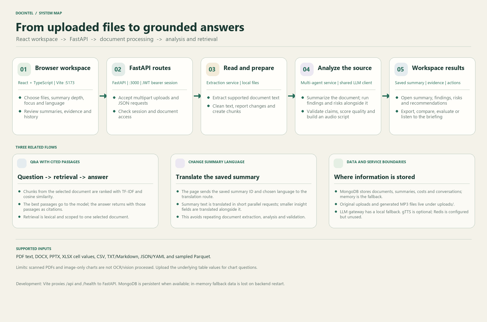
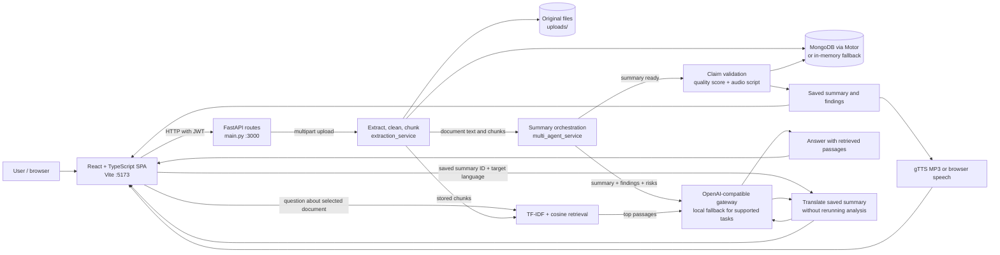

# Document Intelligence Platform — Architecture

This document describes the checked-in implementation. It distinguishes working code from infrastructure that is only configured or named in the UI.



## 1. System at a glance

The project is a local web application with a React/TypeScript single-page frontend and a FastAPI backend. The browser sends JSON and multipart HTTP requests to FastAPI. In development, Vite proxies `/api` and `/health` to port `3000`.



`architecture_workflow.png` is a static overview. The Mermaid flow above is the compact editable version.

## 2. User flows and data movement

### Upload and personalized summary

1. The user selects one or more files and optionally enters a question, summary depth, focus area, and personalization priorities in `frontend/src/pages/DocumentUpload.tsx`.
2. The page sends each file in turn to `POST /api/v1/documents/upload` as multipart form data. It then sends the resulting document ID and the selected summary options to `POST /api/v1/summaries/generate`.
3. `main.py` checks the session, validates the file extension and size, writes the uploaded bytes under `uploads/`, and calls `extraction_service`.
4. Extraction produces text for the supported format. Cleaning normalizes text and returns a cleaning report. Metadata and simple hierarchical chunks are generated and stored with the document.
5. `multi_agent_service.py` starts summary generation alongside source-based findings and structured risk/recommendation analysis. It directly answers an optional upload question, validates claims after the summary is ready, computes a quality score, builds an audio script, and saves the summary and cost record.
6. The API returns IDs and content. The browser opens the summary page for a single uploaded file; for multiple files it keeps the per-file results associated with each upload job.

### Document question and answer

1. The user opens a specific document and asks a question.
2. `POST /api/v1/documents/{document_id}/qa` checks ownership and non-empty question length (up to 2,000 characters).
3. `retrieval_service.py` computes word-level TF-IDF vectors and cosine similarity over the document's chunks. The route requests up to eight relevant chunks.
4. `llm_service.py` creates an answer from the question and retrieved excerpts. If the provider cannot be used, a local rule-based fallback attempts an evidence-based response.
5. The response contains the question, answer, retrieved chunks (`citations`), and suggested follow-up questions. Messages are saved to the conversation store.

The retriever is lexical; it does not use embeddings or a vector database. Related concepts that use different words may rank poorly. The model and fallback answer quality depends on the extracted text and retrieved excerpts.

### Change a summary's language

The summary page posts the saved summary ID and target language to `POST /api/v1/summaries/{summary_id}/translate`. The backend translates the existing summary and its short insight fields, then returns the localized content to the page. It does not re-extract the document or rerun summary analysis and validation. The selected translation is held in page state; the original saved summary remains unchanged.

### Audio

The summary pipeline creates a narration script; it does not synthesize audio as part of summary generation. A separate `POST /api/v1/audio/generate` request invokes gTTS and saves an MP3 under `uploads/audio/`. If gTTS or its network request fails, the endpoint reports no audio file and the frontend can use browser speech synthesis. The generated-file route checks summary access before streaming audio.

## 3. Backend modules

| File | Responsibility |
|---|---|
| `main.py` | FastAPI application, startup/shutdown, CORS, JWT demo sign-in, access checks, health/readiness, and HTTP route handlers. |
| `app/config.py` | Pydantic Settings; reads environment and `.env` values for server, database, gateway, JWT, upload, and budget settings. |
| `app/schemas.py` | Request/response validation models, including login. |
| `app/database.py` | Motor/MongoDB persistence and process-local in-memory fallback for documents, summaries, costs, conversations, users, and organizations. |
| `app/services/extraction_service.py` | File text extraction, cleanup report, metadata, and size/overlap-based paragraph chunks. |
| `app/services/retrieval_service.py` | TF-IDF/cosine chunk ranking and deterministic 3D topic-node coordinates. |
| `app/services/llm_service.py` | OpenAI-compatible chat-completion requests, response parsing, validation helpers, Q&A, and local rule-based fallback. |
| `app/services/multi_agent_service.py` | Summary stages, user-question handling, findings, structured analysis, claim validation, score, trace, audio script, persistence and cost records. These are application stages calling the same LLM service, not separately deployed agents. |
| `app/services/evaluation_service.py` | ROUGE calculations, heuristic evidence/groundedness analysis, and GovReport sample evaluation. |
| `app/services/audio_service.py` | Optional gTTS MP3 creation. |
| `app/services/comparison_service.py` | Text-based difference and comparison output for two documents. |
| `app/services/cost_service.py` | Cost summaries, budget calculations, reading-time and estimated business-value calculations. |
| `app/services/demo_service.py` | Inserts synthetic domain examples and, where available, two GovReport rows as demo documents. |
| `app/data/train-00000-of-00002.parquet`, `train-00001-of-00002.parquet` | GovReport data used by the benchmark (where readable in the local environment). |

### File extraction boundaries

The upload endpoint accepts `.pdf`, `.docx`, `.pptx`, `.xlsx`, `.txt`, `.md`, `.csv`, `.json`, `.yaml`, `.yml`, `.parquet`, and `.pq` files. DOCX/PPTX extraction reads Office XML; XLSX reads worksheet cell values; CSV and text formats are read as text; JSON/YAML are retained as text; PDF uses `pypdf` embedded-text extraction. Uploaded Parquet extraction samples up to 15 rows. PDF chart images, scanned pages, embedded figures, and image-only content are not OCR/vision parsed; XLSX chart graphics are not interpreted. A bar chart should be provided as underlying spreadsheet/CSV data or accompanied by readable labels and values.

Cleanup uses string heuristics for repeated headers/footers/page numbers, whitespace, duplicate lines, and common OCR-like character artifacts. The cleaning screen's OCR wording describes cleanup of text that already contains OCR artifacts; it does not perform OCR on a scan.

## 4. Frontend modules

| File | Responsibility |
|---|---|
| `frontend/src/main.tsx` | Browser React root. |
| `frontend/src/App.tsx` | Router, auth provider, protected routes, theme selection/persistence, shared navbar. |
| `frontend/src/api.ts` | `apiFetch`, which attaches the JWT saved in local storage. |
| `frontend/src/context/AuthContext.tsx` | Login/session state and token/profile persistence. |
| `frontend/src/components/ProtectedRoute.tsx` | Redirects unauthenticated users to `/login`. |
| `frontend/src/components/Navbar.tsx` | Navigation, document conversation history, account controls, and theme toggle. |
| `frontend/src/components/ThreeDocumentNetwork.tsx` | Three.js network visualization component. |
| `frontend/src/pages/LoginPage.tsx` | Demo workspace sign-in and product overview. |
| `frontend/src/pages/DocumentUpload.tsx` | Multi-file upload, voice/text prompt, personalization and progress. |
| `frontend/src/pages/DocumentList.tsx` | Document library and comparison selection. |
| `frontend/src/pages/HistoryView.tsx` | Processing history. |
| `frontend/src/pages/SummaryView.tsx` | Summary, evidence claims, findings, risks, recommendations, audio. |
| `frontend/src/pages/CleaningObservatoryView.tsx` | Raw/cleaned text and cleanup metrics view. |
| `frontend/src/pages/DocComparisonView.tsx` | Document comparison display. |
| `frontend/src/pages/QualityCenterView.tsx` | Saved-summary evaluation and GovReport benchmark UI. |
| `frontend/src/pages/CostDashboard.tsx` | Organization costs, budget and ROI estimates. |
| `frontend/src/pages/SettingsView.tsx` | Frontend settings controls; values are currently UI-local rather than persisted to backend configuration. |
| `frontend/src/App.css` | Shared design system, page layouts, themes, and responsive styling. |
| `frontend/vite.config.ts` | Vite dev server on 5173 and local proxy to backend port 3000. |

## 5. API groups

All application routes are declared in `main.py`; OpenAPI interactive docs are at `/docs`.

| Group | Routes (high-level) |
|---|---|
| Health | `GET /health`, `GET /ready` |
| Session | `POST /api/v1/auth/login`, `GET /api/v1/auth/me` |
| Documents | upload/list/get/delete, cleaning report, topic clusters |
| Summaries | generate/get/list/export/translate saved summary |
| Q&A | document question route and conversation list |
| Audio | generate and access-checked MP3 stream |
| Analysis | compare documents, evaluate summary, GovReport evaluation, quality analytics |
| Demo | load sample documents and create stress-test text |
| Costs | organization costs and budget status |

Most document and summary routes require a JWT bearer token. Cost/budget and stress-test routes currently have no user dependency in `main.py`; review before exposing publicly. Login is demo authentication: the password is hard-coded as `password123`, any email can receive a standard demo profile, and this is not production-grade identity management.

## 6. Persistence and infrastructure

- **MongoDB + Motor** is the persistent document database when it connects. The application also keeps a process-local memory copy/cache and falls back to in-memory operation if MongoDB is unavailable. In-memory-only data is lost when the backend process stops.
- **Local filesystem** stores original uploads and generated audio under `UPLOAD_DIR` (default `uploads/`). `s3Key` is a field name; the checked-in implementation uses local paths, not S3.
- **Redis** is configured in `.env.example` and provisioned by Docker Compose, but current Python request code does not use Redis. It is not a required development dependency.
- `docker-compose.yml` can provision MongoDB, Redis, backend, frontend, and optional Nginx. The standard Windows path is `start.bat`; it starts Mongo/Redis only when Docker is running, then opens backend and frontend terminal windows.
- There is no WebSocket endpoint in the current backend. Processing progress in the upload UI is client-side progress feedback while HTTP requests run.

## 7. Technology choices and trade-offs

| Choice | Why it fits this project | Trade-off |
|---|---|---|
| FastAPI + Python | Async HTTP handlers, typed request validation, Python ecosystem for document/data processing, and generated OpenAPI docs. | Async syntax does not make CPU-heavy parsing parallel automatically; long-running jobs currently occupy request lifetimes. |
| React + TypeScript + Vite | Componentized UI, typed API-facing data, quick local iteration and straightforward proxying. | The SPA and API are separate dev servers locally. |
| MongoDB + Motor | Flexible document-shaped records with asynchronous driver support; in-memory fallback helps demos start without MongoDB. | Fallback is volatile; MongoDB remains necessary for persistence across backend restarts. |
| TF-IDF + cosine retrieval | Lightweight, explainable lexical retrieval without an embedding API or vector store. | Less semantic recall than embedding/hybrid retrieval, especially for paraphrases. |
| OpenAI-compatible LLM gateway + local fallback | Provider can be configured via environment; the app can produce a basic local fallback response if a key is absent or provider fails. | The fallback is heuristic and lower quality; gateway access/network and model availability affect output. |
| Local files for uploads | Simple, inspectable local development and Docker volume persistence. | Not horizontally scalable shared storage; backup, retention, and access controls need production design. |

These are design trade-offs, not benchmarked claims of superiority over commercial document platforms. This app is most useful when a project needs an inspectable, adaptable workflow and reviewable code. Dedicated OCR, embeddings, a queue, and managed identity may be better for production workloads requiring scanned-document coverage, high scale, or enterprise security.

## 8. Quality and known limitations

- The UI labels parts of the Quality Center “DeepEval”, but `requirements.txt` does not include DeepEval; the checked-in evaluator implements ROUGE and lightweight heuristics itself.
- Some values shown as relevance/completeness/confidence are computed or defaulted scores, not calibrated statistical probabilities or an independent guarantee of correctness. GovReport ROUGE is meaningful only in relation to its sampled reference and implementation.
- PDF text extraction cannot read text that exists only inside a raster chart or scan. No OCR/vision model is wired into ingestion.
- TF-IDF retrieval only sees extracted text. Questions over multiple documents are not implicitly cross-document; ask against the selected document or use comparison features.
- The demo login is intentionally permissive. Replace it with real identity, role policy, secret rotation, and production CORS configuration before deployment.
- `SettingsView` is a UI mock/control surface and does not update runtime backend settings.
- A successful `/health` reports process status, not external LLM availability. `/ready` reports the database mode; neither proves a model call will succeed.

## 9. Verification checklist

From the repository root:

```powershell
.\venv\Scripts\python.exe -m compileall -q main.py app
```

From `frontend/`:

```powershell
npm run build
```

The frontend's TypeScript check can run independently with `npx tsc --noEmit`. The repository has `test_regression.py`, but it is a standalone HTTP script rather than pytest-discoverable tests; it also needs to be kept aligned with the JWT-protected API before it is treated as an automated regression suite.
