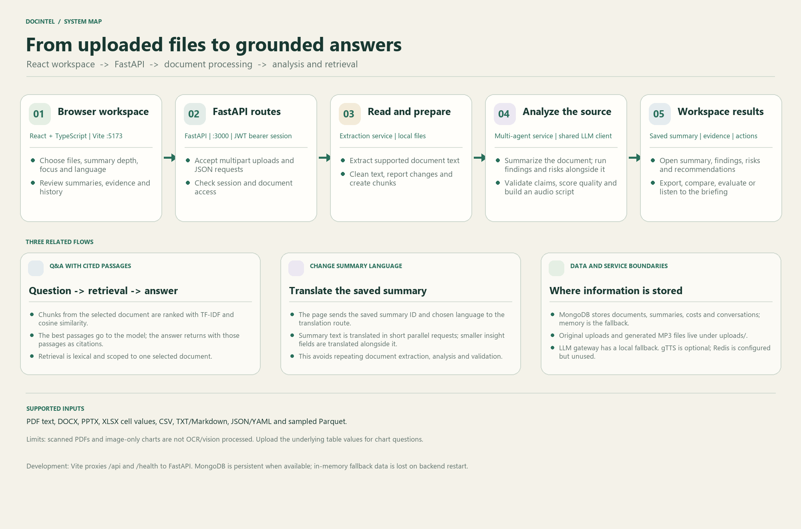
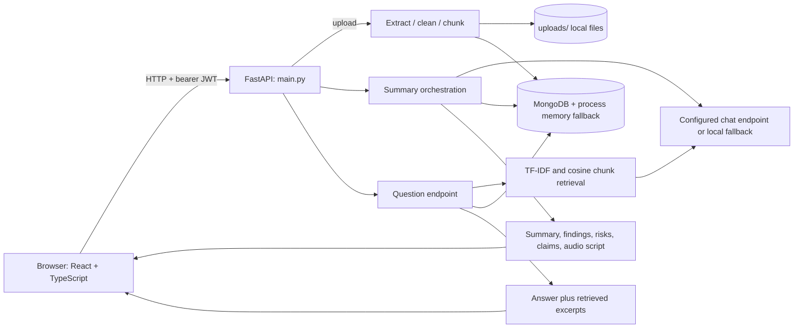

# DocIntel — Project Review & Presentation Guide

This is a presenter-ready walkthrough of the application and its implementation. Claims below describe the code in this repository; distinguish current behavior from possible future work during a review.



## Suggested opening

> DocIntel is a web application for turning readable business and technical documents into summaries, focused answers, evidence excerpts, and audio briefings. A React interface sends authenticated requests to a FastAPI service. The backend extracts and cleans supported document text, breaks it into overlapping chunks, then uses a configurable language-model endpoint and lightweight retrieval to produce useful, reviewable results.

## Slide 1 — The problem

Organizations hold reports, research, policies, meeting notes, spreadsheets, and technical documents in formats that are slow to inspect manually. A conventional “upload a file, return a paragraph” workflow has several shortcomings: the user’s actual question can be overlooked, answers can lose their source context, different file types need different extraction, and summaries are hard to review when outputs are not organized.

**Project goal:** keep a document linked to its extracted source, help a user request a particular angle, and show useful downstream material (findings, risk items, claim excerpts, comparisons, and narration) in one workspace.

**Presenter note:** describe this as a document analysis assistant and review workflow. It is not a replacement for an accountant, lawyer, compliance officer, or domain expert.

## Slide 2 — What the user can do

1. Sign in to the local demo workspace.
2. Upload one or several documents and enter a typed or spoken question.
3. Choose executive or detailed summary depth and a focus such as financial impact, risks and decisions, recommendations, technical architecture, or governance.
4. Review a summary, key findings, risks, recommendations, action items, validation claims, and an audio script.
5. Ask follow-up questions against a selected document; inspect the retrieved text excerpts returned as citations.
6. Browse the document library and history, compare two documents, inspect extracted/cleaned text, run the GovReport evaluation, and view cost estimates.

**Input formats accepted by the upload route:** PDF, DOCX, PPTX, XLSX, TXT, Markdown, CSV, JSON, YAML, and Parquet. The extraction method depends on the file type; see the limitations section.

## Slide 3 — Architecture

The static workflow is in [`architecture_workflow.png`](./architecture_workflow.png); the editable technical version is in [`architecture.md`](./architecture.md).



### The request path, in plain language

- The browser is the user interface. `apiFetch` attaches the saved JWT token to API calls.
- FastAPI verifies the token on most document and summary routes and checks document ownership before access.
- Upload bytes are saved under `uploads/`. The extraction service returns text; it does not keep a visual representation of the file.
- Extracted text is cleaned, measured, split into chunks, and stored with the document record.
- Summary generation uses one orchestrator with a sequence of purpose-specific stages. It is not a cluster of independently running agents or a separate orchestration framework.
- Follow-up Q&A ranks chunks from the selected document, sends relevant excerpts to the LLM service, and returns the selected excerpts in the response.
- MongoDB stores records when available. The process-local fallback helps local demos continue without MongoDB, but its records disappear when the backend restarts.

## Slide 4 — The upload and summary workflow

```text
Select file(s) + prompt + focus
             ↓
POST /api/v1/documents/upload
             ↓
Save original → extract → clean/report → metadata → chunks → persist
             ↓
POST /api/v1/summaries/generate with documentId and options
             ↓
Analyze → generate summary → answer optional prompt → findings / risks / recommendations
             ↓
Validate claims → compute project quality score → build narration script
             ↓
Persist summary + cost record → return summary to the page
```

`DocumentUpload.tsx` processes selected files one by one. Each file receives its own document ID and summary ID, preserving which summary belongs to which source. It submits summary type, focus area, custom instructions, target language, and the user question in the request configuration.

The summary orchestrator in `app/services/multi_agent_service.py` does the following:

1. Collects or generates chunks and basic metadata.
2. Calls `llm_service.generate_summary` with the requested type/focus/language.
3. If a prompt/question was supplied at upload, performs a separate answer task. Ordinal letter questions use a literal-text helper; other questions retrieve relevant chunks first. The answer is appended under an explicit question heading in the summary.
4. Requests key findings and structured risks/recommendations/action items, plus a summary validation result. These follow-up provider requests run concurrently.
5. Produces a numeric application quality score, a trace, and an audio narration script, then saves the summary and cost record.

The stages are useful for organization and traceability, but they all share the same `llm_service`; “agent” is the project’s stage name, not a separate model or autonomous agent runtime.

## Slide 5 — Question answering and source references

```text
Question + selected document ID
             ↓
Access check → document chunks → TF-IDF vectors → cosine similarity
             ↓
Top 8 relevant chunks → LLM answer (or local fallback)
             ↓
Answer + retrieved excerpts + follow-up suggestions
```

The retrieval service is self-contained Python; it does not call an embedding model or a vector database. The Q&A route saves the exchange in conversation history. The returned `citations` are the ranked source chunks. They help a user inspect context, but should not be presented as formal page-accurate citations: chunk records do not consistently retain page numbers.

Question scope is intentional. A question is sent with one `documentId`, and retrieval searches that document’s chunks. Uploading two documents does not implicitly merge them into one answer. Use the comparison page when the task is explicitly to compare sources.

## Slide 6 — Repository tour: what each important file does

### Backend

| Path | Explanation for the review |
|---|---|
| `main.py` | Creates the FastAPI app, handles startup/shutdown, exposes routes, authenticates bearer tokens, checks ownership, and connects UI actions to services. |
| `app/config.py` | Loads settings from environment and `.env`: port, gateway, database, JWT, upload size/path, and budget defaults. |
| `app/schemas.py` | Pydantic models such as login input. |
| `app/database.py` | Async MongoDB access plus in-memory fallback for the core record types. |
| `app/services/extraction_service.py` | Format-specific text extraction, text cleanup/report, metadata and overlapping chunks. |
| `app/services/retrieval_service.py` | TF-IDF, cosine scoring and a deterministic node layout for the 3D topic view. |
| `app/services/llm_service.py` | Chat completions, prompt/response handling, findings, structured analysis, validation and heuristic local fallback. |
| `app/services/multi_agent_service.py` | Coordinates summary stages and persistence; this is the central analysis flow. |
| `app/services/evaluation_service.py` | ROUGE-N/ROUGE-L and source-overlap/grounding heuristics, including a GovReport sample path. |
| `app/services/audio_service.py` | Calls gTTS, writes generated MP3 files, returns a fallback payload on failure. |
| `app/services/comparison_service.py` | Compares document text and constructs a change result. |
| `app/services/cost_service.py` | Computes cost, budget and estimated value/ROI data. |
| `app/services/demo_service.py` | Creates synthetic examples and may add two records from the included GovReport Parquet file. |
| `app/data/*.parquet` | Benchmark dataset files used by demo/evaluation services. |

### Frontend

| Path | Explanation for the review |
|---|---|
| `frontend/src/main.tsx` | React DOM bootstrap. |
| `frontend/src/App.tsx` | Routes, shared layout, authentication provider, and persisted light/dark choice. |
| `frontend/src/api.ts` | Fetch wrapper that adds the locally stored bearer token. |
| `frontend/src/context/AuthContext.tsx` | Sign-in, current user and browser token state. |
| `frontend/src/components/ProtectedRoute.tsx` | Keeps workspace routes behind sign-in. |
| `frontend/src/components/Navbar.tsx` | Brand, navigation, account controls, history drawer and theme control. |
| `frontend/src/components/ThreeDocumentNetwork.tsx` | Three.js document-network view. |
| `frontend/src/pages/LoginPage.tsx` | Demo sign-in screen and feature overview. |
| `frontend/src/pages/DocumentUpload.tsx` | Multi-file upload and user-specific summary request. |
| `frontend/src/pages/DocumentList.tsx` | Library list, search and two-document selection. |
| `frontend/src/pages/SummaryView.tsx` | Summary results, validation, findings and audio controls. |
| `frontend/src/pages/HistoryView.tsx` | Paginated processing history. |
| `frontend/src/pages/CleaningObservatoryView.tsx` | Displays extraction cleanup report and text. |
| `frontend/src/pages/DocComparisonView.tsx` | Displays comparison response. |
| `frontend/src/pages/QualityCenterView.tsx` | Invokes quality and GovReport evaluation routes. |
| `frontend/src/pages/CostDashboard.tsx` | Shows usage/cost/budget estimates. |
| `frontend/src/pages/SettingsView.tsx` | Current settings UI state; not connected to persisted backend settings. |
| `frontend/src/App.css` | Shared type, color, theme, responsive and component styles. |
| `frontend/vite.config.ts` | Starts Vite on port 5173 and proxies API/health requests to port 3000. |

### Run and deployment support

| Path | Explanation |
|---|---|
| `start.bat` | Windows quick start; starts local backend/frontend windows and MongoDB/Redis only if Docker is running. |
| `start.sh` | Shell script for the Compose stack. It requires Docker and Docker Compose. |
| `docker-compose.yml` | Optional MongoDB, Redis, backend, frontend and Nginx containers. Redis is not currently used in Python request handling. |
| `Dockerfile`, `frontend/Dockerfile`, `nginx.conf` | Container builds and optional reverse proxy. |
| `.env.example` | Names/defaults for configurable environment variables. Copy to `.env`, add a valid provider key if needed, and keep it out of version control. |
| `requirements.txt`, `frontend/package.json` | Python and JavaScript dependencies. |

## Slide 7 — Technology stack and rationale

| Technology | Use here | Why it is a reasonable fit | Trade-off to explain honestly |
|---|---|---|---|
| Python 3.11 | Backend and document/data services | Strong text/data ecosystem and readable service code. | CPU-intensive extraction is not automatically parallelized by `async`. |
| FastAPI + Uvicorn | HTTP API server | Async routes, validation and OpenAPI documentation are available with a small setup. | Long summary/model requests are synchronous request flows; no job queue currently handles them. |
| Pydantic Settings | Typed configuration | Keeps environment settings in one place. | Secrets and production overrides still need disciplined deployment management. |
| React + TypeScript | Web app | Reusable UI components and compile-time checking for frontend code. | Requires a separate frontend build/dev server and API integration. |
| Vite | Frontend tooling | Fast development server and straightforward API proxy. | Dev proxy configuration is local; production routing needs deployment setup. |
| MongoDB + Motor | Persistent document-shaped records | Flexible records and asynchronous database driver. | MongoDB must be reachable for persistence; fallback is volatile. |
| TF-IDF + cosine | Chunk retrieval | Lightweight, inspectable, deterministic lexical matching with no vector infrastructure. | Embeddings/hybrid search can retrieve semantic paraphrases more effectively. |
| LLM gateway + fallback | Generation and analysis | Provider endpoint/model can be configured separately from UI; fallback keeps basic workflows available. | Gateway credentials/connectivity and model behavior affect quality; local fallback is heuristic. |
| pypdf / Office XML / openpyxl / pandas / PyArrow | File readers | Use the libraries suited to each text/office/table format. | They extract textual or cell data; they do not provide general visual understanding/OCR. |
| gTTS / Web Speech API | Narration | MP3 can be generated when network/service is available; browser speech is a useful fallback. | gTTS needs network access; browser voices vary by browser/device. |

### How to answer “why this instead of another product?”

Frame this as a project design choice, not a claim that DocIntel beats commercial platforms. DocIntel is useful for a review because its ingestion, cleaning, retrieval, generation, and storage path can be inspected and adapted locally. It avoids requiring a paid vector database for the demo and can start with an in-memory fallback. The trade-off is that it is not a managed enterprise product: identity, OCR, scalable background processing, vector search, production observability, and hardened retention need more work. A managed document platform may be preferable when those features and service guarantees matter more than code-level control.

## Slide 8 — Security, quality and limitations

- **Demo identity:** The login route uses the literal demo password `password123`; any email can receive a standard profile. JWT and owner checks demonstrate request scoping but do not make the demo a production identity system.
- **Data isolation:** Document reads and summary routes use owner checks, with administrator access logic. Review all endpoints before exposure: costs, budget, and stress-test endpoints currently do not all use the same user dependency.
- **CORS:** `main.py` currently allows all origins. Tighten this for deployment.
- **Files:** uploads are local files. There is no S3 integration even though records use the `s3Key` field name.
- **PDF:** pypdf extracts selectable embedded text. There is no OCR or image/diagram/chart vision stage. The cleaning heuristics may fix OCR-like text artifacts only after text exists.
- **Tables and charts:** XLSX cell data is converted into text rows; chart pictures are not read. CSV is text. Uploaded Parquet ingestion samples up to 15 rows.
- **Retrieval:** lexical query matching only; results are scoped to one document. Returned excerpts are evidence hints, but page-level citation metadata is not guaranteed.
- **Evaluation:** despite UI labels, there is no DeepEval dependency in `requirements.txt`. The evaluator contains ROUGE calculations and rule-based text overlap/grounding heuristics. Scores are not calibrated probabilities. GovReport comparisons are sample/reference-dependent.
- **Settings:** the settings page currently updates client-side values/messages; it does not reconfigure the running backend.
- **Redis:** Compose starts it and Settings defines its URL, but application request code does not currently use it.
- **Reliability:** `/health` is a process-level check. `/ready` reports DB connection/fallback mode; neither validates the LLM provider end to end.

## Slide 9 — Live demonstration script

1. Start the application with `start.bat` and open `http://localhost:5173`.
2. Sign in with `admin@company.com` / `password123` (demo only).
3. Use a short, text-readable PDF or DOCX, or upload an XLSX/CSV with labels and numeric values.
4. Enter a focused question such as “Did sales increase between the first and last quarter? Quote the values you used.” Choose Financial Impact and Detailed.
5. Wait for the document upload and summary request. Explain the linked document ID, returned answer paragraph, findings, risks and validation claims.
6. Open the resulting summary; point out that claim excerpts and Q&A excerpts are there to aid review against the source.
7. Ask a follow-up question inside that document and show the citations/excerpts. Explain that another document is not silently mixed into this question.
8. Show the Library and History, then optionally the cleaning report or two-document compare view.
9. If network/provider access is unavailable, demonstrate the local fallback and explain its limits rather than promising model-grade answer quality.

**Demo safety:** use non-sensitive sample files. Do not upload confidential records to a remote model gateway unless the data-handling terms and authorization have been checked.

## Slide 10 — How to run and verify

Windows quick start:

```bat
start.bat
```

Manual backend and frontend commands, environment setup, and the checked verification results are in [`README.md`](./README.md). Open `http://localhost:3000/docs` to inspect the API.

Latest local checks for this review: backend `/health` and `/ready` responded; demo login, authenticated document list and history calls responded; Python compile and TypeScript checks passed; Vite frontend dev server returned HTTP 200. A production `npm run build` could not complete because this environment denied Vite access to its config path. `test_regression.py` is not pytest-discoverable and its current HTTP requests omit JWT, so do not present it as a passing test suite.

## Likely review questions

### How does a question remain tied to its source document?

The frontend sends one document ID to the Q&A endpoint. The backend verifies the caller can access that document, retrieves from that document’s chunks, and returns the selected chunks with the answer. It does not search all uploaded files implicitly.

### How do you reduce hallucinations?

The app retrieves source excerpts for Q&A and runs a summary validation stage that compares claims with source text. The summary response includes status, confidence-style fields, and claim passages. This is a best-effort review aid, not a proof that every generated statement is correct.

### Why not use a vector database?

The project uses TF-IDF/cosine to keep the demo easy to run and retrieval behavior transparent. A future production version could evaluate embeddings or hybrid search against a representative Q&A test set before choosing a vector store.

### What happens if MongoDB is offline?

The application logs the connection issue and falls back to in-memory collections. The current process can continue, but fallback data is not persistent and disappears after a restart.

### Can it analyze a bar chart in a PDF?

It can analyze chart values when those values are included as selectable text or uploaded as spreadsheet/CSV data. The current PDF reader does not OCR or interpret a bar chart image.

### Is the login production ready?

No. It is a demonstration login using a fixed password and permissive profile creation. Production deployment requires a real identity provider, secure account lifecycle, tightened CORS, managed secrets and security review.

## Closing summary

DocIntel demonstrates a complete, explainable application path from supported file formats through extraction, cleanup, chunk retrieval, model-assisted analysis, validation-oriented review, persistence, and a user-facing workspace. Its strongest review points are the separation of responsibilities, explicit document scope for Q&A, user-provided focus/question support, fallback behavior, and visible evidence excerpts. Its limitations are documented so future improvements can target OCR/vision, stronger retrieval, automated tests, background jobs, identity, and production infrastructure.
